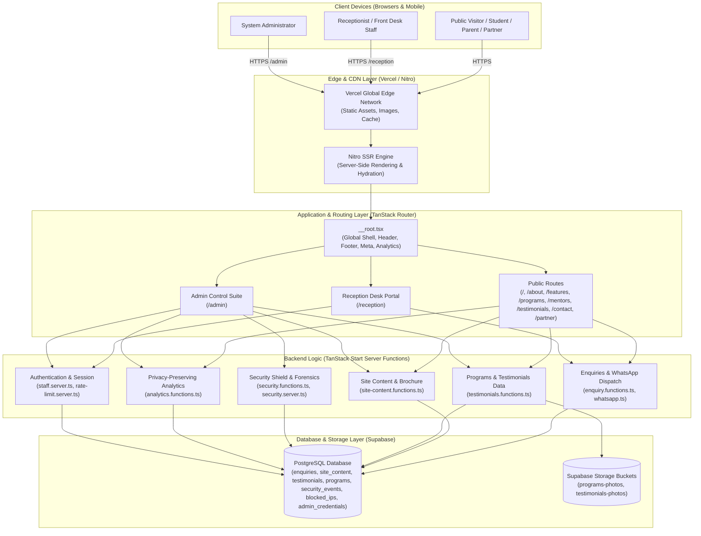
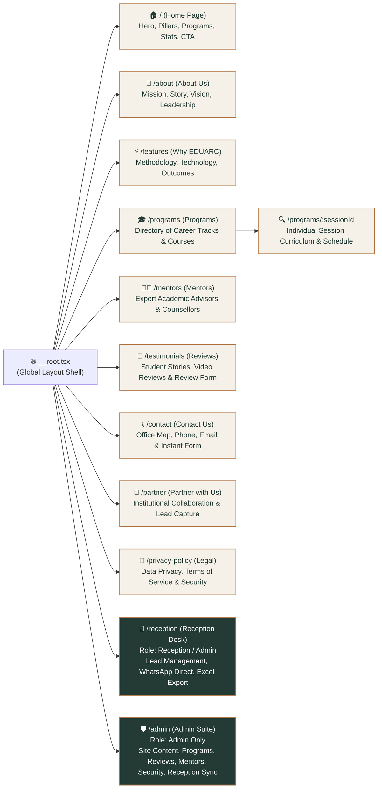
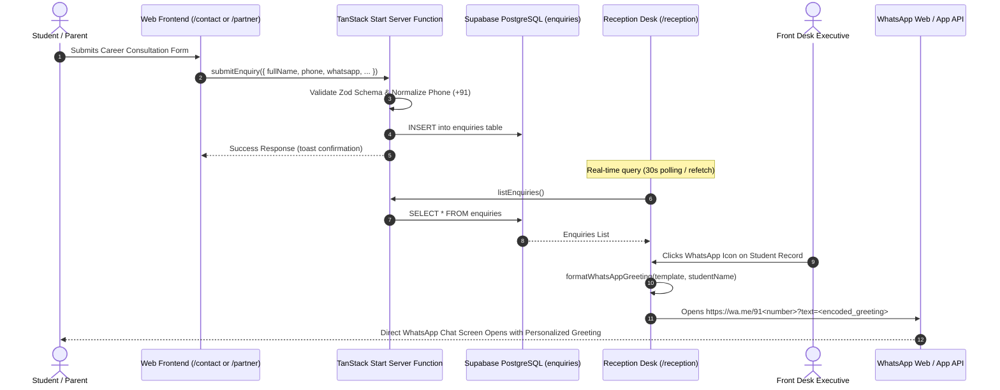

# EDUARC Connect — Project Architecture & Visual Directory Structure

A comprehensive visual reference guide detailing the system architecture, file tree hierarchy, routing blueprint, component relationships, data flow, and visual asset inventory of the **EDUARC Connect** platform.

---

## 1. High-Level System Architecture



---

## 2. Visual Project Directory Tree

```
c:\Users\Home\Desktop\eduarc-connect-portfolio-backup-20261031
├── 📁 public/                         # Public static files served at root
│   ├── 🖼️ favicon.png                  # Browser favicon
│   ├── 🖼️ og-image.jpg                 # OpenGraph social share card (<300KB for WhatsApp)
│   ├── 🖼️ og-logo.png                  # High-res social logo
│   ├── 📄 robots.txt                   # Crawler indexing rules & bot permissions
│   ├── 📄 sitemap.xml                  # Canonical XML sitemap for SEO
│   ├── 📄 llms.txt                     # AI citation & LLM agent documentation
│   └── 📄 llms-full.txt                # Extended LLM context specification
│
├── 📁 src/                            # Application Source Code
│   │
│   ├── 📁 assets/                     # Packaged visual media & brand imagery
│   │   ├── 📁 programs/               # Institutional & campus program photography
│   │   │   ├── 📁 session/            # Dynamic session media
│   │   │   └── 🖼️ program-*.jpg       # Campus partner photography (9 institutions)
│   │   ├── 📁 testimonials/           # Student & parent testimonial photos
│   │   │   ├── 🖼️ hero-banner.jpg     # Testimonials page visual banner
│   │   │   ├── 🖼️ success-books.jpg   # Success visual card
│   │   │   └── 🖼️ *.jpg               # Verified student avatars (Ananya, Meera, Priya...)
│   │   ├── 🖼️ about-hero.jpg          # About section hero banner
│   │   ├── 🖼️ about-vision.jpg        # About vision & leadership visual
│   │   ├── 🖼️ about-desk.jpg          # Academic consultation desk photo
│   │   ├── 🖼️ contact-hero-counselor-hd.jpg # HD Counselor imagery for Contact hero
│   │   ├── 🖼️ contact-guidance-bg.png # Guidance background pattern
│   │   ├── 🖼️ eduarc-mark.png         # EDUARC icon mark
│   │   ├── 🖼️ eduarc-text.png         # EDUARC typographic wordmark
│   │   ├── 🖼️ features-hero.jpg       # Features & methodology hero banner
│   │   ├── 🖼️ hero-students-clean.jpg # Home page hero students visual
│   │   ├── 🖼️ mentor-gayathri.jpg     # Lead mentor profile image
│   │   └── 🖼️ testimoials hero banner.jpg # Top-level hero banner for reviews
│   │
│   ├── 📁 components/                 # React UI Component Hierarchy
│   │   │
│   │   ├── 📁 site/                   # Public marketing & brochure UI
│   │   │   ├── 📁 sections/           # Modular page content sections
│   │   │   │   ├── ⚛️ AboutContent.tsx        # Comprehensive About page sections
│   │   │   │   ├── ⚛️ ContactContent.tsx      # Contact cards, maps & office info
│   │   │   │   ├── ⚛️ FeaturesContent.tsx     # Pillars, methodology & features
│   │   │   │   ├── ⚛️ PartnerContent.tsx      # Institutional collaboration guide
│   │   │   │   ├── ⚛️ ProgramsSection.tsx     # Interactive programs list & filter
│   │   │   │   └── ⚛️ TestimonialsContent.tsx # Reviews grid, filters & submit form
│   │   │   ├── ⚛️ AnalyticsTracker.tsx        # Zero-cookie pageview & interaction tracking
│   │   │   ├── ⚛️ BrandLogo.tsx               # Reusable responsive EDUARC brand logo
│   │   │   ├── ⚛️ icons.tsx                   # Curated SVG icons
│   │   │   ├── ⚛️ MagneticDockNav.tsx         # Floating magnetic navigation dock
│   │   │   ├── ⚛️ PageTransition.tsx          # Smooth route transition wrapper
│   │   │   ├── ⚛️ PaperPlaneButton.tsx        # Animated interactive submission CTA
│   │   │   ├── ⚛️ PartnerForm.tsx             # Multi-role enquiry submission wizard
│   │   │   ├── ⚛️ ProgressiveImage.tsx        # Lazy-loaded progressive blur-up image
│   │   │   ├── ⚛️ Reveal.tsx                  # Scroll-triggered entrance animations
│   │   │   ├── ⚛️ Section.tsx                 # Standardized section container & spacing
│   │   │   ├── ⚛️ SiteHeader.tsx              # Sticky glassmorphic navigation header
│   │   │   └── ⚛️ SiteFooter.tsx              # Comprehensive footer with quick links
│   │   │
│   │   ├── 📁 admin/                  # Secure Administrator Workspace UI
│   │   │   ├── ⚛️ AdminDashboard.tsx          # Main multi-tab admin navigation shell
│   │   │   ├── ⚛️ AdminLogin.tsx              # Brute-force protected admin login gate
│   │   │   ├── ⚛️ AnalyticsAdminPanel.tsx     # Traffic & conversion metrics dashboard
│   │   │   ├── ⚛️ editors.tsx                 # Live visual editors (Home, About, Features, Partner)
│   │   │   ├── ⚛️ fields.tsx                  # Admin form inputs, panels & controls
│   │   │   ├── ⚛️ MentorsEditor.tsx           # Mentor profile & expertise manager
│   │   │   ├── ⚛️ PasswordPanel.tsx           # Password change & credential reset UI
│   │   │   ├── ⚛️ ProgramsEditor.tsx          # Programs CRUD & storage image uploader
│   │   │   ├── ⚛️ ReceptionAdminPanel.tsx     # Enquiries manager, Excel export & WhatsApp
│   │   │   ├── ⚛️ SecurityAdminPanel.tsx      # Real-time firewall, IP forensics & blocks
│   │   │   └── ⚛️ TestimonialsEditor.tsx      # Reviews moderation, photo replace & CRUD
│   │   │
│   │   ├── 📁 reception/              # Receptionist Operations Portal UI
│   │   │   ├── ⚛️ ReceptionDashboard.tsx      # Daily lead inbox, filters & status board
│   │   │   ├── ⚛️ enquiry-components.tsx      # Enquiry cards, details modal & actions
│   │   │   └── ⚛️ WhatsAppTemplateModal.tsx   # Custom WhatsApp greeting editor & preview
│   │   │
│   │   └── 📁 ui/                     # Design System Primitives (Radix UI + Tailwind)
│   │       ├── ⚛️ badge.tsx                   # Tag & status badges
│   │       ├── ⚛️ button.tsx                  # Rounded pill & standard buttons
│   │       ├── ⚛️ card.tsx                    # Surface card wrappers
│   │       ├── ⚛️ dialog.tsx                  # Accessible modal dialogs
│   │       ├── ⚛️ input.tsx                   # Text input fields
│   │       ├── ⚛️ label.tsx                   # Form labels
│   │       ├── ⚛️ sonner.tsx                  # Toast notification toaster
│   │       ├── ⚛️ tabs.tsx                    # Multi-panel tab bar
│   │       ├── ⚛️ textarea.tsx                # Multi-line textareas
│   │       └── ⚛️ toggle-group.tsx            # Segmented toggle controls
│   │
│   ├── 📁 content/                    # Single-Source-of-Truth Copy & Data Fallbacks
│   │   ├── 📄 eduarc.ts               # Core brochure content, prices, programs, FAQs
│   │   └── 📄 programs-data.ts        # Comprehensive programs syllabus & session data
│   │
│   ├── 📁 integrations/               # External Services & Database Integrations
│   │   └── 📁 supabase/
│   │       ├── 📄 auth-attacher.ts    # Server session credential attacher
│   │       ├── 📄 client.server.ts    # Secure Service Role client (bypasses RLS safely)
│   │       ├── 📄 client.ts           # Public client (anon key)
│   │       └── 📄 types.ts            # Auto-generated TypeScript database definitions
│   │
│   ├── 📁 lib/                        # Server Functions, Utilities & Business Logic
│   │   ├── 🛡️ admin.functions.ts      # Admin auth, session verification & password update
│   │   ├── 🛡️ enquiry.functions.ts    # Lead submission, counselling status & admin delete
│   │   ├── 🛡️ programs.functions.ts   # Programs DB CRUD & Supabase storage image upload
│   │   ├── 🛡️ testimonials.functions.ts # Testimonials CRUD, user submissions & review queue
│   │   ├── 🛡️ security.functions.ts   # Firewall event logging, IP block/unblock, forensics
│   │   ├── 🛡️ security.server.ts      # Automated threat detection (SQLi, XSS, rate-limits)
│   │   ├── 🛡️ security-detector.ts    # In-memory heuristic attack signature analyzer
│   │   ├── 🛡️ site-content.functions.ts # Site content live overrides & DB merge
│   │   ├── 🛡️ staff.server.ts         # Encrypted cookies & PBKDF2 password authentication
│   │   ├── 🛡️ rate-limit.server.ts    # Sliding-window IP brute-force limiter
│   │   ├── 📄 enquiry.ts              # Enquiry schemas, mobile normalizer & WhatsApp link generator
│   │   ├── 📄 whatsapp.ts             # WhatsApp greeting template state & storage manager
│   │   ├── 📄 export-excel.ts         # Formatted XML Excel spreadsheet generator
│   │   ├── 📄 image-compression.ts    # Client-side progressive image compression (WebP)
│   │   ├── 📄 avatar.ts               # High-contrast accessible avatar generator
│   │   ├── 📄 analytics-client.ts     # Client event dispatchers & beacon sender
│   │   ├── 📄 analytics.functions.ts  # Server analytics ingestion & reporting
│   │   └── 📄 utils.ts                # Tailwind class name merger (clsx + twMerge)
│   │
│   ├── 📁 routes/                     # TanStack Router File-Based Routing
│   │   ├── 🌐 __root.tsx              # Root HTML shell, SEO head tags & layout wrapper
│   │   ├── 🌐 index.tsx               # Home Page (/)
│   │   ├── 🌐 about.tsx               # About Us Page (/about)
│   │   ├── 🌐 features.tsx            # Features & Methodology (/features)
│   │   ├── 🌐 programs.tsx            # All Programs Directory (/programs)
│   │   ├── 🌐 programs_.$sessionId.tsx # Individual Program Detail (/programs/:sessionId)
│   │   ├── 🌐 mentors.tsx             # Academic Mentors & Counsellors (/mentors)
│   │   ├── 🌐 testimonials.tsx        # Student & Parent Stories (/testimonials)
│   │   ├── 🌐 contact.tsx             # Contact & Campus Location (/contact)
│   │   ├── 🌐 partner.tsx             # Institutional Partnership (/partner)
│   │   ├── 🌐 privacy-policy.tsx      # Legal, Terms & Privacy (/privacy-policy)
│   │   ├── 🔒 admin.tsx               # Administrator Control Gate (/admin)
│   │   └── 🔒 reception.tsx           # Receptionist Desk Portal (/reception)
│   │
│   ├── 📁 test/                       # Comprehensive Vitest Automated Test Suite
│   │   ├── 🧪 enquiry.test.ts         # Enquiries schema, normalization & WhatsApp tests
│   │   ├── 🧪 auth-security.test.ts   # Rate-limiting, password hashing & auth guard tests
│   │   ├── 🧪 admin-password.test.ts  # Password reset & credential validation
│   │   ├── 🧪 testimonials.test.ts    # Testimonials DB CRUD & photo replace tests
│   │   ├── 🧪 security-monitoring.test.ts # Firewall event capture & IP blocking tests
│   │   ├── 🧪 analytics.test.ts       # Privacy-preserving analytics test
│   │   ├── 🧪 image-compression.test.ts # WebP image optimization tests
│   │   ├── 🧪 seo-sitemap.test.ts     # Sitemap, robots.txt & metadata verification
│   │   ├── 🧪 site-header.test.tsx    # Navigation & responsive menu tests
│   │   ├── 🧪 animation-systems.test.tsx # Framer motion & reveal tests
│   │   └── 🧪 app-routing.test.tsx    # Router definition & route loading tests
│   │
│   ├── 📄 app.config.ts               # Nitro & TanStack Start build configuration
│   └── 📄 styles.css                  # Tailwind CSS tokens, typography & design utilities
│
├── 📁 supabase/                       # Supabase Database Migrations & Schemas
│   └── 📄 schema.sql                  # Complete SQL schema, RLS policies & tables
│
├── 📁 docs/                           # Project Manuals & Operational Documentation
│   ├── 📄 DEPLOYMENT_GUIDE.md         # Step-by-step Vercel & Supabase production setup
│   ├── 📄 REPAIR_CHECKLIST.md         # System validation checklist
│   ├── 📄 SECURITY_AUDIT.md           # Security audit findings & mitigations
│   ├── 📄 TESTING_REPORT.md           # Vitest testing coverage report
│   └── 📄 WEBSITE_AUDIT.md            # UX, accessibility & SEO audit report
│
├── 📄 AGENTS.md                       # Agent instructions & architectural golden rules
├── 📄 package.json                    # Project metadata, dependencies & scripts
├── 📄 tsconfig.json                   # TypeScript configuration
└── 📄 README.md                       # High-level overview & quickstart
```

---

## 3. Visual Route & Page Hierarchy



---

## 4. End-to-End Enquiry & WhatsApp Data Flow



---

## 5. Security & Access Control Model

| Portal / Operation | Authentication Gate | Access Level | Protected Actions |
|---|---|---|---|
| **Public Site** (`/`, `/about`, `/programs`, etc.) | None (Public) | Read-only | Browse brochures, submit enquiries, submit student review |
| **Reception Portal** (`/reception`) | Session Cookie (`eduarc_staff_session`) | Staff / Receptionist / Admin | View enquiries, update counselling status, export Excel, WhatsApp redirect |
| **Admin Control Suite** (`/admin`) | Session Cookie (`eduarc_staff_session`) + `role: "admin"` | Administrator Only | Edit all site copy, manage database programs & testimonials, replace/delete photos, permanent enquiry deletion, IP blocking & firewall rules |
| **Server Functions** (`*.functions.ts`) | `requireAdmin()` or `requireStaffSession()` | Server-Enforced | Direct database mutations, Supabase admin storage manipulation, credential modification |

---

## 6. Visual Media & Photography Catalog

All core visual media assets are organized in [`src/assets/`](file:///c:/Users/Home/Desktop/eduarc-connect-portfolio-backup-20261031/src/assets):

1. **Brand Identity**:
   - `eduarc-mark.png`: Iconic geometric brand symbol.
   - `eduarc-text.png`: Premium brand typography logo.
2. **Hero Photography**:
   - `hero-students-clean.jpg`: High-energy group of ambitious students for Home hero.
   - `features-hero.jpg`: Modern educational environment for Features hero.
   - `about-hero.jpg`: Campus architecture and student interaction.
   - `contact-hero-counselor-hd.jpg`: Dedicated career counsellor in professional consultation session.
   - `testimoials hero banner.jpg`: Student celebration & achievement banner.
3. **Institutional Campus Photography** (`src/assets/programs/`):
   - 9 verified partner campus visuals (`program-vit-vellore.jpg`, `program-psg-college.jpg`, `program-bishop-heber.jpg`, `program-st-marys.jpg`, etc.).
4. **Verified Student Avatars** (`src/assets/testimonials/`):
   - Authenticated student and parent profile photos for high-trust testimonials.

